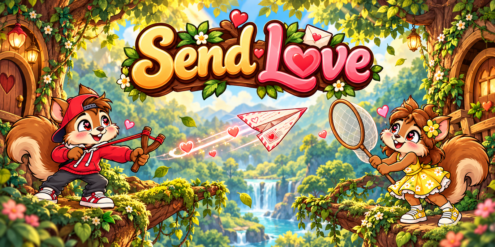

# Send Love 💌



**Uma carta, duas árvores e um amor que sempre encontra um caminho.**

Send Love é um jogo web 2D de precisão e física, desenvolvido para jogar no navegador em computadores, celulares e tablets. Explore a floresta, ajuste a força do estilingue e envie um aviãozinho de papel com uma carta de amor até a puçá do seu par.

## Sobre o jogo

Dois esquilos apaixonados vivem em tocas de árvores distantes. Para trocar mensagens, um lança cartas dobradas em aviões de papel com um estilingue, enquanto o outro espera com uma puçá. Como eles vivem mudando de endereço, cada fase traz novas posições, alturas e distâncias para calcular.

Antes de começar, informe seu nome e escolha entre o esquilo de boné vermelho e a esquila de vestido amarelo. O personagem escolhido envia as cartas, e seu par recebe do outro lado da floresta.

O alvo fica fora da tela do lançador. Arraste o cenário para descobrir onde ele está, observe sua altura e volte ao estilingue para planejar o disparo. A mira mostra apenas o início da trajetória: acertar depende da sua observação, do ângulo e da força aplicada.

## Como jogar

1. Informe seu nome e escolha um dos personagens. Em telas touch, use o teclado virtual do próprio jogo.
2. Experimente o tutorial guiado para aprender a explorar, mirar e lançar sem perder tentativas.
3. Arraste uma área vazia da floresta ou toque em **Encontrar meu amor** para localizar a puçá.
4. Volte usando **Meu galho**, pressione o avião e puxe para trás e para baixo.
5. Ajuste o ângulo e a força. Quanto maior o esticamento, mais longe o avião pode alcançar.
6. Solte para lançar e acompanhe a carta até o destino.

### Pontuação e progressão

- Cada fase oferece **três lançamentos**.
- Cada carta entregue vale **um ponto e uma estrela**.
- Com um, dois ou três acertos, você avança para a próxima fase com a avaliação correspondente.
- Três erros encerram a partida, mostram a reação triste dos personagens e iniciam uma contagem regressiva para recomeçar.
- As fases continuam sem uma última etapa, variando as posições e distâncias entre as árvores.
- O ranking prioriza as fases concluídas e, em seguida, a pontuação. Os recordes ficam salvos no navegador e dispositivo utilizados.

### Controles

| Ação | Mouse ou teclado | Touch |
| --- | --- | --- |
| Explorar a floresta | Clicar e arrastar uma área vazia | Tocar e arrastar uma área vazia |
| Mirar e definir a força | Pressionar o avião e arrastar | Segurar o avião e arrastar |
| Lançar a carta | Soltar o botão do mouse | Soltar o dedo |
| Cancelar a mira | Escape ou botão Cancelar | Botão Cancelar |
| Pausar | Escape fora da mira ou botão Pausa | Botão Pausa |
| Localizar os personagens | Botões de câmera | Botões de câmera |
| Controlar o som | Botão de nota musical e ajustes na pausa | Mesmos botões |

## Recursos

- Floresta ilustrada, árvores com tocas e plataformas em forma de galhos.
- Dois personagens com 12 poses cada, incluindo mira, lançamento, recepção, comemoração e tristeza.
- Avião com inclinação durante o voo, movimento das dobras e rastro visual.
- Estilingue com elástico deformável, indicador de força e previsão parcial da parábola.
- Câmera explorável e acompanhamento automático do avião.
- Cenário com parallax, folhas em movimento e partículas de luz.
- Geração de fases com verificação de trajetórias possíveis.
- Estrelas animadas, resultados por fase e pontuação imediata.
- Tutorial interativo e teclado virtual com letras acentuadas.
- Ambiente de floresta e efeitos de lançamento, entrega, comemoração, erro e conclusão.
- Pausa, ajustes independentes de volume e tela cheia quando suportada pelo navegador.
- Interface em português brasileiro, adaptada para mouse e touch.

## Tecnologias utilizadas

### Jogo e interface

| Tecnologia | Utilização |
| --- | --- |
| **JavaScript — ES Modules** | Regras, física balística, estados da partida e geração das fases |
| **HTML5 Canvas 2D** | Renderização do cenário, personagens, sprites e efeitos visuais |
| **HTML5 e CSS3** | Telas, HUD, botões, teclado virtual e interface responsiva |
| **Pointer Events** | Controles unificados para mouse e toque |
| **Web Audio API** | Síntese do ambiente de floresta e dos efeitos sonoros |
| **localStorage** | Perfil, preferências, tutorial e ranking local |
| **WebP e atlas de sprites** | Imagens comprimidas e organização dos quadros de animação |

### Desenvolvimento e validação

| Tecnologia | Utilização |
| --- | --- |
| **Node.js e npm** | Execução das ferramentas e gerenciamento das dependências |
| **Vite** | Servidor de desenvolvimento e build para publicação |
| **Node.js Test Runner** | Testes automatizados de física, câmera, pontuação e progressão |
| **Happy DOM e esbuild** | Testes integrados da interface em um DOM simulado |
| **Sharp** | Preparação, alinhamento e compressão dos assets |
| **@napi-rs/canvas** | Geração de prévias das cenas para inspeção visual |
| **imagegen** | Criação de artes e poses a partir das referências visuais do projeto |

## Executar localmente

### Pré-requisitos

- Node.js 22 ou superior.
- npm instalado com o Node.js.
- Navegador atualizado com suporte a Canvas 2D e JavaScript.

Na pasta do projeto, execute:

```bash
npm install
npm run dev
```

Abra **http://localhost:5174/**.

No PowerShell, caso a política de scripts impeça executar `npm.ps1`, utilize:

```powershell
npm.cmd install --cache .npm-cache
npm.cmd run dev
```

### Inicializador para Windows

Abra **`jogar.bat`** com dois cliques. Ele instala as dependências quando necessário e abre o jogo no navegador. Se o Send Love já estiver rodando, reutiliza a instância existente; se a porta estiver ocupada por outro programa, procura uma porta livre.

Quando o inicializador criar um servidor, mantenha a janela aberta durante a partida. Para encerrar, pressione **Ctrl+C**.

### Testar no celular ou tablet

Conecte o aparelho à mesma rede Wi-Fi do computador e abra o endereço **Network** exibido no terminal pelo servidor. Se necessário, permita a conexão do Node.js na rede privada pelo firewall do Windows.

A orientação horizontal oferece mais espaço para observar o cenário. O jogo também se adapta ao modo retrato e possui teclado virtual para jogar sem teclado físico.

## Testes e publicação

```bash
npm test
npm run build
npm run preview
```

O build gera a pasta **`dist/`**, pronta para hospedagem de arquivos estáticos. O comando `preview` permite conferir o resultado localmente, normalmente em **http://localhost:4174/**.

Os testes cobrem 4.000 configurações de fases, captura em alta velocidade, limite de força, pontuação, ranking e câmera em sete formatos de tela. O teste integrado percorre seleção de personagem, teclado virtual, tutorial, entrega, estrelas, avanço e derrota. A conferência em navegadores e aparelhos reais complementa essas verificações.

## Estrutura do projeto

```text
assets/                 Referências, capa e recursos visuais
  game/                 Imagens WebP e atlas utilizados no jogo
  generated/            Artes geradas e prompts de produção
src/
  main.js               Fluxos, interface e controles
  physics.js            Balística, captura e geração das fases
  camera.js             Campo de visão e movimentação da câmera
  renderer.js           Renderização das cenas e efeitos
  art.js                Catálogo de assets e estados das animações
  audio.js              Ambiente e efeitos sonoros
  storage.js            Perfil, preferências e ranking
  styles.css            Estilos da interface
scripts/                Inicializador e ferramentas de preparação visual
tests/                  Testes automatizados
GDD.md                  Documento de design do jogo
REAVALIACAO.md           Registro da revisão 0.2
index.html              Página de entrada
jogar.bat               Inicializador para Windows
vite.config.js          Configuração do servidor e build
```

## Portfólio

Conheça outros projetos de **Denilsom Lobo**:

**[Acessar meu portfólio](https://portifolio-denilsom-lobo.web.app/)**

## Jogue no navegador

**Link do jogo:** _Em breve — espaço reservado para adicionar o endereço do Send Love publicado._

<!-- Após publicar, substitua a frase acima por: [Jogar Send Love](URL_DO_JOGO) -->
